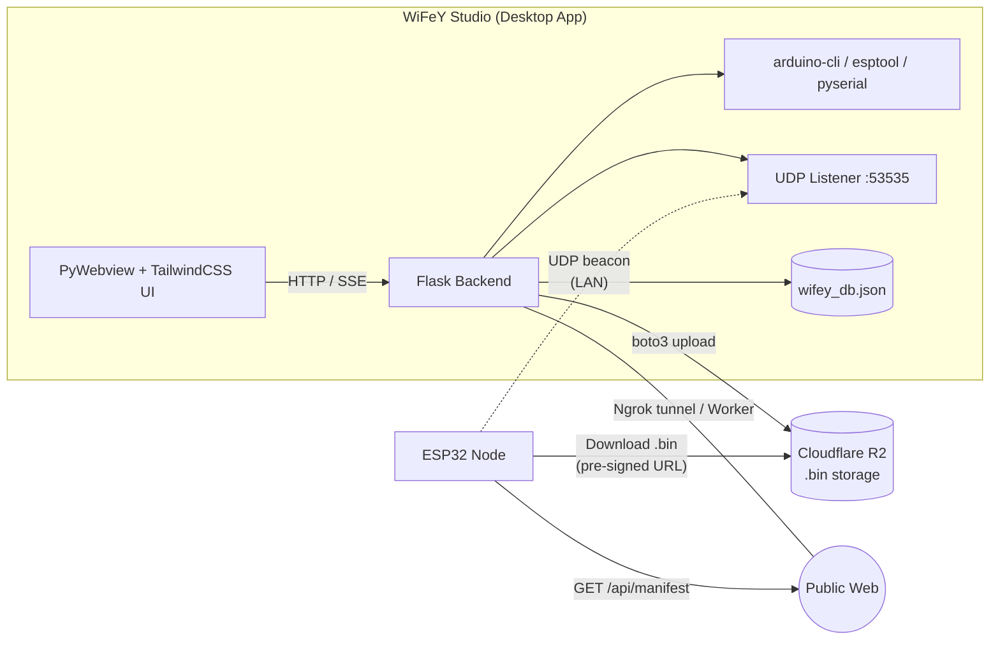
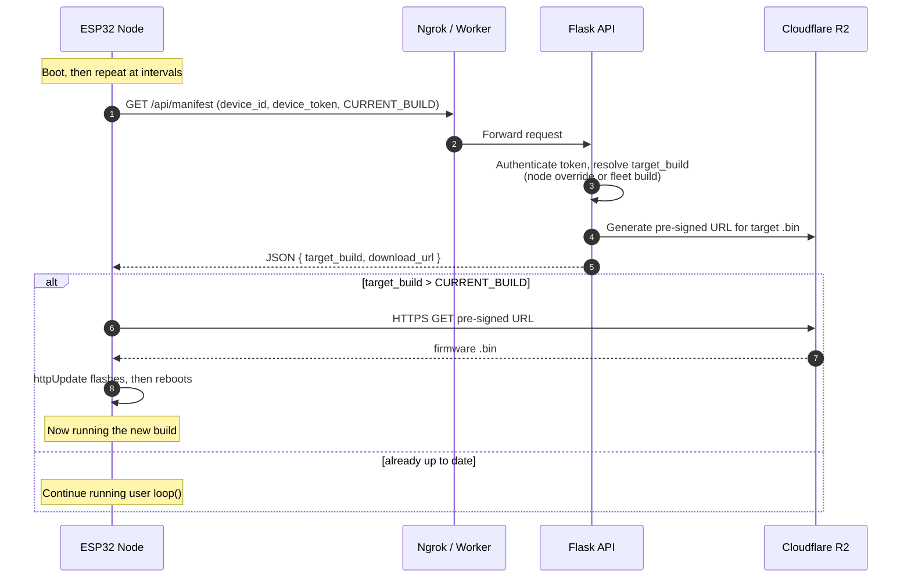
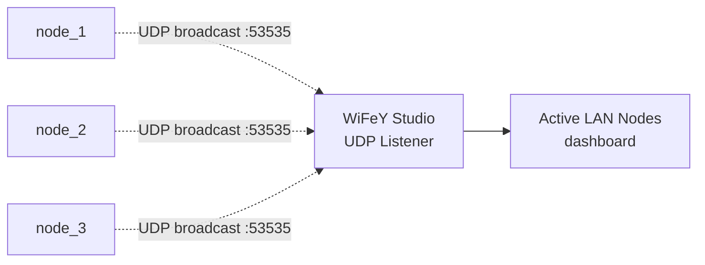
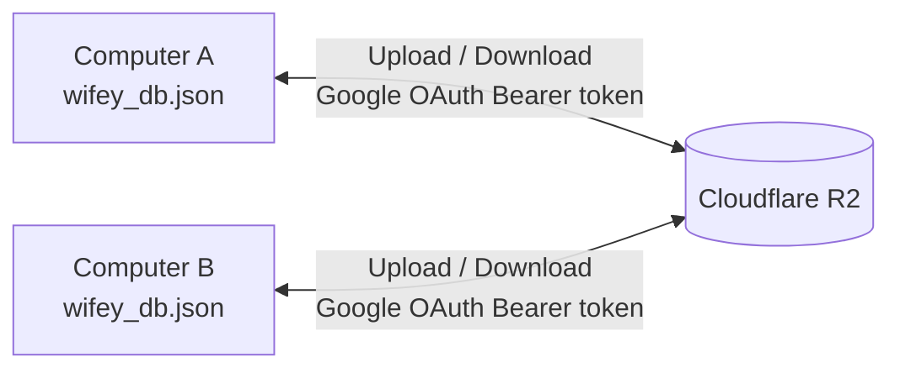

<div align="center">

# 📡 WiFeY Studio

**A cross-platform IDE and fleet manager for Over-The-Air (OTA) firmware updates on ESP32 microcontrollers.**

Write once. Compile locally. Deploy wirelessly. Never touch a USB cable again.

[](https://www.python.org/)
[](https://flask.palletsprojects.com/)
[](https://tailwindcss.com/)
[](https://www.espressif.com/)
[](https://arduino.github.io/arduino-cli/)
[](https://www.cloudflare.com/developer-platform/products/r2/)
[](#2-installation)
[](LICENSE)

</div>

---

## 📖 Table of Contents

1. [Introduction](#1-introduction)
2. [Installation](#2-installation)
   - [Prerequisites](#prerequisites)
   - [Install](#install)
   - [Secure Uninstaller](#secure-uninstaller)
3. [Usage & Features](#3-usage--features)
   - [Quick Start Workflow](#quick-start-workflow)
   - [Settings & Cloud Configuration](#31-settings--cloud-configuration)
   - [Code Editor (IDE)](#32-code-editor-ide)
   - [Direct USB Provisioning](#33-direct-usb-provisioning)
   - [OTA Deployment](#34-ota-deployment)
   - [Fleet Manager](#35-fleet-manager)
4. [Deep Dive: Architecture & How It Works](#4-deep-dive-architecture--how-it-works)
   - [System Overview](#41-system-overview)
   - [The Smart C++ Code Wrapper](#42-the-smart-c-code-wrapper)
   - [Pull-Based OTA Architecture](#43-pull-based-ota-architecture)
   - [UDP LAN Discovery](#44-udp-lan-discovery)
   - [Live CLI Streaming](#45-live-cli-streaming)
   - [Cloud Syncing](#46-cloud-syncing)
5. [Tech Stack](#5-tech-stack)
6. [Security Notes](#6-security-notes)
7. [Contributing](#7-contributing)
8. [License](#8-license)

---

## 1. Introduction

**WiFeY Studio** is a cross-platform desktop application and IoT provisioning platform for managing, compiling, and deploying firmware updates to **fleets of ESP32 microcontrollers**. It is two tools in one:

- 🖥️ **A local IDE** — write Arduino C++ and compile it with a managed, invisible [Arduino CLI](https://arduino.github.io/arduino-cli/) toolchain.
- ☁️ **A cloud-synced fleet manager** — publish builds to Cloudflare R2, track every node, and control exactly which firmware each device should run.

### The Problem

Updating deployed ESP32 boards usually means walking to each device, plugging in a USB cable, selecting the right COM port, and re-flashing. This does not scale past a handful of devices, and it is impractical for boards that are mounted in enclosures, installed in remote locations, or simply numerous.

### The Solution

After a **one-time USB provisioning step**, every device in the field becomes remotely updatable. WiFeY Studio uses a robust **pull-based OTA architecture**: devices periodically ask the cloud *"which build should I be running?"* and, if a newer build is assigned, download and flash it themselves. There is no MQTT broker to host, no inbound port to open on the device, and no persistent connection to maintain.

### Highlights

| Capability | Description |
|---|---|
| **Zero-boilerplate firmware** | You write only `setup()` and `loop()`. WiFeY injects Wi-Fi, OTA, manifest polling, and UDP beaconing. |
| **One-click deploy** | Compile and push a `.bin` to Cloudflare R2 straight from the UI. |
| **Per-node build control** | Pin individual nodes to a specific build while the rest of the fleet stays on another. |
| **LAN auto-discovery** | Nodes announce themselves over UDP so the dashboard shows live devices without internet pings. |
| **Real-time logs** | Compiler, flasher, and Serial Monitor output stream live into the UI via SSE. |
| **Multi-computer sync** | Sync your fleet database across machines with Google OAuth-secured cloud storage. |
| **Native installers** | Builds into a standalone `.exe`, `.app`, or Linux binary with a desktop shortcut. |

---

## 2. Installation

WiFeY Studio ships with a single cross-platform installer script, **`WiFeY-Installer.py`**, which handles dependencies, packaging, and shortcuts.

### Prerequisites

- **Python 3.10 or newer** (with `pip`)
- An internet connection for the first run (dependencies and the Arduino toolchain are downloaded)

### Install

```bash
python WiFeY-Installer.py
```

Then choose **Option 1** from the interactive menu:

```text
==============================
        WiFeY Installer
==============================
  1) Install WiFeY Studio
  2) Secure Uninstall
==============================
Select an option: 1
```

#### What the installer does

| Step | Action |
|:---:|---|
| 1 | Detects your operating system (Windows, macOS, or Linux). |
| 2 | Automatically installs any missing `pip` dependencies: `flask`, `pyserial`, `boto3`, `pyngrok`, `pywebview`, `requests`, `python-dotenv`, and `PyInstaller`. |
| 3 | Compiles the Flask application into a **standalone native executable** using PyInstaller. |
| 4 | Creates a **desktop shortcut** automatically so you can launch WiFeY Studio like any other app. |

**Resulting artifacts per platform**

| Platform | Output |
|---|---|
| 🪟 Windows | `.exe` |
| 🍎 macOS | `.app` bundle |
| 🐧 Linux | Native binary |

### Secure Uninstaller

Uninstalling WiFeY Studio removes cached data, environment variables, and the managed toolchain. Because that is destructive, the uninstaller is **protected against unauthorized wipes**.

```bash
python WiFeY-Installer.py   # then select Option 2
```

**How the secure uninstall works**

1. The installer **spawns a temporary local server on port `5000`**.
2. You are forced through a **Google OAuth login** in your browser.
3. The installer takes your Google account's unique `google_sub` ID and **verifies it against the owner record in the local `wifey_db.json`**.
4. Only if the IDs match does it proceed to delete:
   - 🗑️ Application caches
   - 🗑️ Environment variables set by WiFeY Studio
   - 🗑️ The managed Arduino toolchain

If verification fails, nothing is removed.

> **Note:** Port `5000` must be free during uninstallation.

---

## 3. Usage & Features

### Quick Start Workflow

```text
Settings ──► Code Editor ──► USB Provisioning (once per device) ──► OTA Deploy ──► Fleet Manager
   │              │                      │                               │               │
 R2 / Ngrok    setup() +             Flash Bootloader               Compile + push    Monitor nodes,
 / OAuth       loop() only           sketch, get device_token       .bin to R2        assign overrides
```

1. Configure your cloud credentials in **Settings**.
2. Write your logic in the **Code Editor**.
3. Plug in a new ESP32 and **provision it over USB** (only once).
4. Click **Deploy** — from now on, updates happen wirelessly.
5. Watch and control everything from the **Fleet Manager**.

---

### 3.1 Settings & Cloud Configuration

Open **Settings** to connect WiFeY Studio to your cloud services.

| Section | What you provide | Purpose |
|---|---|---|
| **Cloudflare R2** | Account ID, Access Key ID, Secret Access Key, Bucket name | S3-compatible storage for compiled `.bin` firmware files and cloud sync of your fleet database. |
| **Ngrok** | Auth token and **static domain** | Tunnels your local Flask API to the public web so devices can reach `/api/manifest` from anywhere. A static domain keeps the URL baked into firmware stable. |
| **Google OAuth 2.0** | OAuth **Client ID** | Powers multi-tenant authentication, cloud sync authorization, and the secure uninstaller. |
| **Gateway (optional)** | Cloudflare Worker URL | Use a Cloudflare Worker as the public gateway instead of an Ngrok tunnel. |

> **Tip:** Create your R2 bucket as **private**. Devices never access it directly; they receive short-lived pre-signed URLs from the manifest endpoint.

---

### 3.2 Code Editor (IDE)

WiFeY Studio includes a built-in editor for **standard Arduino C++**. You write only your own logic:

```cpp
// Your code. That's it.
const int LED_PIN = 2;

void setup() {
  pinMode(LED_PIN, OUTPUT);
}

void loop() {
  digitalWrite(LED_PIN, HIGH);
  delay(500);
  digitalWrite(LED_PIN, LOW);
  delay(500);
}
```

You do **not** write any of the following; the IDE handles it for you:

- Wi-Fi connection and reconnection
- Manifest polling and build comparison
- The OTA download and flashing routine
- UDP discovery beacons
- Non-blocking timing so OTA checks keep running alongside your `loop()`

See [The Smart C++ Code Wrapper](#42-the-smart-c-code-wrapper) for how this works.

---

### 3.3 Direct USB Provisioning

Every device must be introduced to your fleet exactly once, over USB. This is the **only** time a cable is needed.

1. Connect the ESP32 to your computer.
2. In the UI, select the device's **COM / serial port**.
3. Choose the **fleet** the device will join and give the node a name (e.g., `node_1`).
4. Click **Provision**. WiFeY Studio flashes the initial **"Bootloader" sketch**, which:
   - Registers the device with your chosen fleet
   - Generates a unique **`device_token`** used to authenticate every future manifest request
   - Embeds the base logic required for OTA
5. Flashing progress streams live into the browser (see [Live CLI Streaming](#45-live-cli-streaming)).

After this step the device pulls its real firmware wirelessly.

---

### 3.4 OTA Deployment

Once devices are provisioned:

1. Write or edit your sketch in the Code Editor.
2. Click **Compile & Deploy**.
3. WiFeY Studio:
   - Wraps your code in the master template
   - Compiles it with Arduino CLI
   - Increments the build number
   - Uploads the resulting `.bin` to **Cloudflare R2**
   - Updates the fleet's target build
4. Each device picks up the new build on its **next manifest check**; no action is required on the device.

---

### 3.5 Fleet Manager

The Fleet Manager is your operational dashboard.

| Feature | Description |
|---|---|
| **Active nodes** | See every registered device and whether it is online. |
| **Last-seen timestamps** | Know exactly when each node last contacted the manifest endpoint. |
| **Create fleets** | Group devices logically (e.g., `greenhouse`, `warehouse`, `prototype`). |
| **Active LAN Nodes** | Live view of devices discovered via UDP beacons on your local network. |
| **Custom build overrides** | Assign a specific build number to an individual node, independent of its fleet. |

#### Build Overrides in Practice

Overrides let you canary-test a new firmware on a single device before rolling it out fleet-wide.

| Node | Fleet target | Override | Effective `target_build` |
|---|:---:|:---:|:---:|
| `node_1` | #100 | **#105** | **105** |
| `node_2` | #100 | none | 100 |
| `node_3` | #100 | none | 100 |

Here the fleet stays on build **#100** while `node_1` is forced to build **#105**. When #105 is validated, promote it as the fleet target and clear the override.

---

## 4. Deep Dive: Architecture & How It Works

### 4.1 System Overview



| Layer | Responsibility |
|---|---|
| **Frontend** | HTML/JS + TailwindCSS + Phosphor Icons, hosted in a native window by **PyWebview**. |
| **Backend** | Flask REST API: compilation, flashing, manifest endpoint, fleet database, R2 access. |
| **Toolchain** | Arduino CLI, downloaded and run in the background; users never configure it. |
| **Storage** | Cloudflare R2 for firmware binaries and cloud-synced state. |
| **Transport** | Ngrok (or an optional Cloudflare Worker) exposes the manifest API; UDP covers LAN discovery. |
| **Auth** | Google OAuth 2.0 for multi-tenant identity. |

---

### 4.2 The Smart C++ Code Wrapper

Users never write networking or OTA code. When you click compile, WiFeY Studio takes your raw C++ and **injects it into a `MASTER_CPP_TEMPLATE`**, a complete, production-grade firmware skeleton, before handing the result to Arduino CLI.

**What the template provides automatically**

| Concern | Handled by the template |
|---|---|
| **Wi-Fi** | Connects on boot and reconnects if the link drops (`WiFi.h`). |
| **Manifest checks** | Uses `HTTPClient` to call `/api/manifest` on boot and on a fixed interval, parsing the response with `ArduinoJson.h`. |
| **OTA flashing** | Calls `httpUpdate` (`HTTPUpdate.h`) to download and flash a newer `.bin`, then reboots. |
| **Non-blocking timing** | Maintenance tasks (manifest polling, UDP beacons, Wi-Fi supervision) are scheduled without blocking the user's `loop()`. |
| **Identity** | Compile-time constants such as `CURRENT_BUILD`, device ID, and `device_token`. |
| **LAN beacon** | Periodically broadcasts a UDP packet on port `53535`. |

**Conceptual shape of the generated sketch** *(simplified and illustrative)*

```cpp
#include <WiFi.h>
#include <WiFiUdp.h>
#include <HTTPClient.h>
#include <HTTPUpdate.h>
#include <ArduinoJson.h>

// ── Injected by WiFeY Studio at compile time ───────────────────
#define CURRENT_BUILD  105
const char* DEVICE_ID    = "node_1";
const char* DEVICE_TOKEN = "<unique device_token>";
const char* MANIFEST_URL = "https://<your-static-domain>/api/manifest";
// ───────────────────────────────────────────────────────────────

// ── Your code, inserted here (setup/loop wrapped) ──────────────
{{USER_CODE}}
// ───────────────────────────────────────────────────────────────

void checkForUpdate() {
  HTTPClient http;
  http.begin(MANIFEST_URL);
  // device_id + device_token are sent for authentication
  if (http.GET() == 200) {
    JsonDocument doc;
    deserializeJson(doc, http.getString());
    int target = doc["target_build"];
    if (target > CURRENT_BUILD) {
      httpUpdate.update(client, doc["download_url"].as<const char*>());
    }
  }
  http.end();
}

void setup() {
  connectWiFi();
  checkForUpdate();     // check on boot
  user_setup();         // your setup()
}

void loop() {
  wifeyTick();          // non-blocking: interval check + UDP beacon
  user_loop();          // your loop()
}
```

> The snippet above illustrates the *concept*. The authoritative template lives in the application source as `MASTER_CPP_TEMPLATE`.

**Why this matters:** because the update logic is compiled into *every* build, a device can never be "orphaned." Each new firmware you push still contains the OTA routine, so the device remains updatable forever.

---

### 4.3 Pull-Based OTA Architecture

WiFeY Studio deliberately **does not use MQTT** or any persistent broker connection. Devices *pull* updates, which keeps the architecture simple and firewall-friendly.



**Step-by-step**

1. **Boot and interval polling.** On power-up and then at a regular interval, the device sends a request to the `/api/manifest` endpoint. The endpoint is reachable from anywhere via an **Ngrok tunnel** (with a static domain) or an optional **Cloudflare Worker gateway**.
2. **Authentication.** The request carries the device's identity and `device_token`, generated during USB provisioning.
3. **Target resolution.** The backend decides which build the device *should* run: the node-specific override if one exists, otherwise the fleet's target build.
4. **Comparison.** The device compares its compiled-in **`CURRENT_BUILD`** integer to the manifest's **`target_build`**.
5. **Download.** If the cloud build is **higher**, the device downloads the `.bin` from the **pre-signed Cloudflare R2 URL** included in the manifest. R2 is never exposed publicly.
6. **Flash and reboot.** `httpUpdate` writes the image to the OTA partition and restarts into the new firmware.

**Example manifest response**

```json
{
  "target_build": 105,
  "download_url": "https://<account>.r2.cloudflarestorage.com/<bucket>/greenhouse/build_105.bin?X-Amz-Signature=..."
}
```

**Why pull instead of push?**

| Benefit | Explanation |
|---|---|
| **NAT / firewall friendly** | Devices make outbound HTTPS requests only; no inbound ports required. |
| **No broker to run** | No MQTT server to host, secure, or scale. |
| **Offline tolerant** | A device that was off for days simply catches up on its next check. |
| **Stateless and simple** | The source of truth is always the manifest; there are no missed messages. |

---

### 4.4 UDP LAN Discovery

Independently of the cloud, nodes announce themselves on the local network so you can see them instantly, **without any internet pinging**.

- Each node **broadcasts a UDP beacon on port `53535`**.
- The beacon contains the node's **Device ID, `device_token`, IP address, and current Build number**.
- A listener thread inside the local Python backend receives these beacons and populates the **"Active LAN Nodes"** dashboard in real time.
- Because the beacon carries the `device_token`, the backend can **validate that a node belongs to the signed-in user**, preserving multi-user isolation on shared Wi-Fi routers where several developers' devices may be broadcasting on the same network.

**Example beacon payload**

```json
{ "device_id": "node_1", "device_token": "dt_...", "ip": "192.168.1.42", "build": 105 }
```



**Use cases:** verifying that a freshly flashed device came up, confirming which build is actually running, and finding a device's IP address on your network.

> **Firewall note:** Allow inbound UDP on port `53535` for WiFeY Studio on the host machine, and make sure the computer and devices share the same subnet (broadcast traffic does not cross routers by default).

---

### 4.5 Live CLI Streaming

Compiling and flashing are long-running command-line operations. A naive implementation would freeze the UI until they finish. WiFeY Studio instead **streams output live**.

| Source | Streamed content |
|---|---|
| `arduino-cli` | Real-time compiler output, warnings, and errors |
| `esptool` | Flashing progress and logs |
| Serial Monitor | Live serial data from a connected device (via `pyserial`) |

**How it works**

1. Flask launches the CLI tool as a **subprocess** and reads its stdout/stderr **line by line**.
2. Each line is pushed to the browser over **Server-Sent Events (SSE)** / chunked **HTTP streaming** responses.
3. The frontend appends each line to the console panel **directly in the DOM** as it arrives.
4. The UI thread is never blocked, so you can keep navigating, editing, or watching other devices during a build.

```text
Browser ◄──── SSE / HTTP stream ◄──── Flask ◄──── subprocess stdout
(DOM append)                         (generator)    arduino-cli | esptool | serial
```

---

### 4.6 Cloud Syncing

All local state (fleets, nodes, tokens, build targets, and overrides) lives in a single JSON file: **`wifey_db.json`**.

To work across multiple computers, WiFeY Studio can **upload and download this database to and from Cloudflare R2**:

- Requests are authorized with a **Google OAuth Bearer token**.
- The token identifies the developer by `google_sub`, giving **multi-tenant isolation**; each developer syncs only their own fleet data.
- **Upload** pushes your current local database to the cloud.
- **Download** restores or merges it on another machine.



Result: install WiFeY Studio on a new laptop, sign in with Google, pull your database, and your entire fleet is there, ready to manage.

---

## 5. Tech Stack

| Layer | Technology |
|---|---|
| **Backend** | Python 3.10+, Flask |
| **Frontend** | HTML / JavaScript, TailwindCSS, Phosphor Icons |
| **Desktop wrapper** | PyWebview |
| **Compiler toolchain** | Arduino CLI (managed and executed in the background) |
| **Flashing / serial** | esptool, pyserial |
| **Packaging** | PyInstaller |
| **Environment config** | python-dotenv |
| **Cloud storage** | Cloudflare R2 (S3-compatible) via `boto3` |
| **Gateway (optional)** | Cloudflare Workers |
| **Authentication** | Google OAuth 2.0 |
| **Tunneling** | Ngrok (`pyngrok`) |
| **LAN discovery** | UDP broadcast (port 53535) |
| **Hardware target** | ESP32 (`HTTPUpdate.h`, `WiFi.h`, `ArduinoJson.h`) |

---

## 6. Security Notes

- **Private bucket.** Keep your R2 bucket private. Devices only ever receive **short-lived pre-signed URLs**.
- **Per-device tokens.** Each node has a unique `device_token`; revoke or re-provision a node to invalidate it.
- **Protect `wifey_db.json`.** It contains fleet data and tokens. Do not commit it to version control.
- **Secrets stay local.** R2 keys, Ngrok tokens, and OAuth configuration are stored on your machine; never commit them.
- **TLS on devices.** For production deployments, validate server certificates on the ESP32 (e.g., by supplying a root CA) rather than disabling verification.
- **Protected uninstall.** Destructive uninstallation requires Google sign-in and a matching `google_sub`.

---

## 7. Contributing

Contributions, bug reports, and feature ideas are welcome.

1. Fork the repository
2. Create a feature branch: `git checkout -b feature/amazing-feature`
3. Commit your changes: `git commit -m "Add amazing feature"`
4. Push the branch: `git push origin feature/amazing-feature`
5. Open a Pull Request

Please open an issue first for large changes so we can discuss the approach.

---

## 8. License

Distributed under the **MIT License**. See [`LICENSE`](LICENSE) for details.

---

<div align="center">

**Built for makers who'd rather ship firmware than hunt for USB cables.**

⭐ If WiFeY Studio helps you, consider starring the repo!

</div>